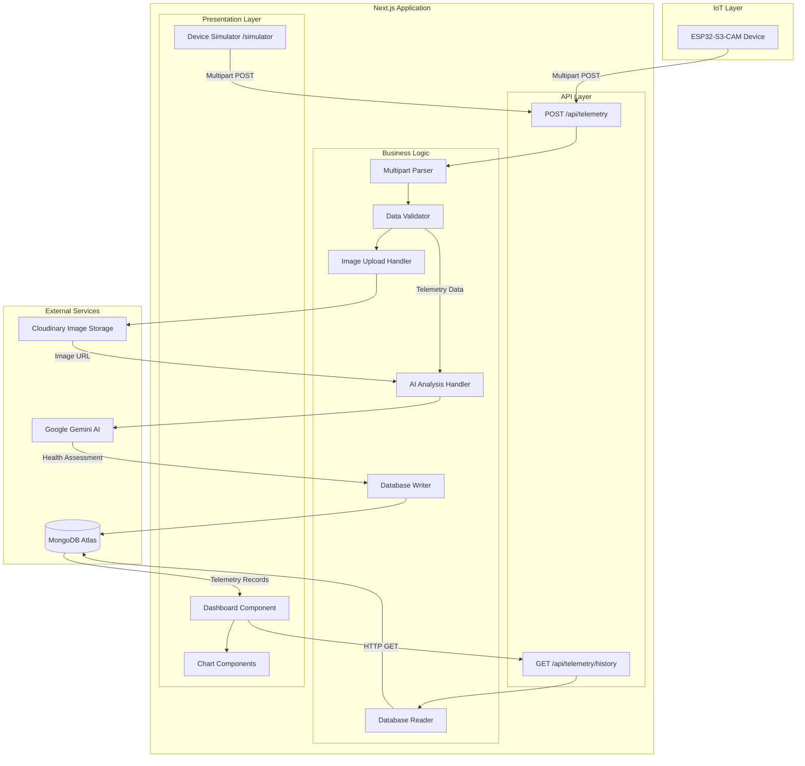

# Design Document: AI-Powered Plant Health Monitoring IoT System

## Overview

The AI-Powered Plant Health Monitoring IoT System is a full-stack **Next.js 16+** application that bridges IoT devices with cloud-based AI services to provide real-time plant health monitoring and analysis. The system receives multimodal telemetry data (environmental sensor readings and images) from ESP32-S3-CAM devices, processes and stores this data, performs AI-powered health analysis using Google Gemini AI, and presents insights through an interactive web dashboard.

### Key Design Principles

- **Serverless Architecture**: Leverage Next.js API routes for serverless backend functionality
- **Multimodal Processing**: Handle both structured sensor data and unstructured image data
- **Cloud-Native Services**: Integrate managed services (MongoDB Atlas, Cloudinary, Google Gemini AI) for scalability
- **Type Safety**: Use TypeScript throughout for compile-time correctness
- **Real-Time Updates**: Implement auto-refresh mechanism for live monitoring
- **Separation of Concerns**: Clear boundaries between data ingestion, storage, analysis, and presentation layers
- **Branded Visual System**: Green/black s.host-inspired palette combined with Material Design 3 structure (see Visual Design System below)

## Architecture

### System Architecture Diagram



### Data Flow

1. **Ingestion Flow**:
   - ESP32-S3-CAM captures environmental readings and image
   - Device sends multipart/form-data POST request to `/api/telemetry`
   - API route parses multipart data extracting image file and sensor fields
   - Validation layer ensures data integrity and type correctness
   - Image uploaded to Cloudinary, returning public URL

2. **Analysis Flow**:
   - Cloudinary image URL and telemetry data passed to AI analysis handler
   - System constructs prompt with environmental context
   - Google Gemini AI analyzes image with sensor data context
   - AI returns structured health assessment (score, status, diagnosis, recommendations)
   - Validation ensures AI response conforms to expected schema

3. **Persistence Flow**:
   - Telemetry data, image URL, and health assessment combined into document
   - Server timestamp added
   - Document persisted to MongoDB via Mongoose model
   - Connection pooling ensures efficient database access

4. **Retrieval Flow**:
   - Dashboard requests data via `/api/telemetry/history` with optional limit parameter
   - Query sorted by timestamp descending (newest first)
   - Records returned as JSON array

5. **Presentation Flow**:
   - Dashboard fetches latest record (limit=1) for current status display
   - Dashboard fetches historical records (limit=50) for trend charts
   - Auto-refresh timer triggers re-fetch every 30 seconds
   - React state updates trigger UI re-render

## Components and Interfaces

### Database Layer

#### MongoDB Schema (Mongoose)

```typescript
// lib/mongodb.ts - Connection Helper

import mongoose from 'mongoose';

const MONGODB_URI = process.env.MONGODB_URI!;

if (!MONGODB_URI) {
  throw new Error('Please define the MONGODB_URI environment variable');
}

/**
 * Global connection cache to prevent multiple connections in development
 * due to hot reloading
 */
let cached = global.mongoose;

if (!cached) {
  cached = global.mongoose = { conn: null, promise: null };
}

async function connectToDatabase() {
  if (cached.conn) {
    return cached.conn;
  }

  if (!cached.promise) {
    const opts = {
      bufferCommands: false,
    };

    cached.promise = mongoose.connect(MONGODB_URI, opts).then((mongoose) => {
      return mongoose;
    });
  }

  try {
    cached.conn = await cached.promise;
  } catch (e) {
    cached.promise = null;
    throw e;
  }

  return cached.conn;
}

export default connectToDatabase;
```

```typescript
// models/Telemetry.ts - Mongoose Model

import mongoose, { Schema, Document, Model } from 'mongoose';

export interface ITelemetry extends Document {
  timestamp: Date;
  temperature: number;
  humidity: number;
  soilMoisture: number;
  imageUrl: string;
  healthScore?: number;
  status?: 'Healthy' | 'Warning' | 'Critical';
  diagnosis?: string;
  recommendedActions?: string[];
}

const TelemetrySchema: Schema = new Schema({
  timestamp: {
    type: Date,
    required: true,
    default: Date.now,
    index: true, // Index for efficient sorting
  },
  temperature: {
    type: Number,
    required: true,
  },
  humidity: {
    type: Number,
    required: true,
    min: 0,
    max: 100,
  },
  soilMoisture: {
    type: Number,
    required: true,
    min: 0,
    max: 100,
  },
  imageUrl: {
    type: String,
    required: true,
  },
  healthScore: {
    type: Number,
    min: 0,
    max: 100,
  },
  status: {
    type: String,
    enum: ['Healthy', 'Warning', 'Critical'],
  },
  diagnosis: {
    type: String,
  },
  recommendedActions: {
    type: [String],
  },
});

// Prevent model recompilation in development
const Telemetry: Model<ITelemetry> =
  mongoose.models.Telemetry || mongoose.model<ITelemetry>('Telemetry', TelemetrySchema);

export default Telemetry;
```

### API Layer

#### POST /api/telemetry

```typescript
// app/api/telemetry/route.ts

import { NextRequest, NextResponse } from 'next/server';
import { v2 as cloudinary } from 'cloudinary';
import connectToDatabase from '@/lib/mongodb';
import { analyzePlantHealth } from '@/lib/gemini';
import Telemetry from '@/models/Telemetry';

// Configure Cloudinary
cloudinary.config({
  cloud_name: process.env.CLOUDINARY_CLOUD_NAME,
  api_key: process.env.CLOUDINARY_API_KEY,
  api_secret: process.env.CLOUDINARY_API_SECRET,
});

interface TelemetryInput {
  temperature: number;
  humidity: number;
  soilMoisture: number;
  image: File;
}

interface HealthAssessment {
  health_score: number;
  status: 'Healthy' | 'Warning' | 'Critical';
  diagnosis: string;
  recommended_actions: string[];
}

export async function POST(request: NextRequest) {
  try {
    // Parse multipart form data
    const formData = await request.formData();
    
    // Extract and validate fields
    const image = formData.get('image') as File | null;
    const temperature = formData.get('temperature');
    const humidity = formData.get('humidity');
    const soilMoisture = formData.get('soilMoisture');

    // Validation
    if (!image || !image.size) {
      return NextResponse.json(
        { error: 'Image file is required' },
        { status: 400 }
      );
    }

    if (!temperature || !humidity || !soilMoisture) {
      return NextResponse.json(
        { error: 'Missing required telemetry fields' },
        { status: 400 }
      );
    }

    const tempValue = parseFloat(temperature as string);
    const humidityValue = parseFloat(humidity as string);
    const soilMoistureValue = parseFloat(soilMoisture as string);

    if (isNaN(tempValue)) {
      return NextResponse.json(
        { error: 'Temperature must be a valid number' },
        { status: 400 }
      );
    }

    if (isNaN(humidityValue) || humidityValue < 0 || humidityValue > 100) {
      return NextResponse.json(
        { error: 'Humidity must be a number between 0 and 100' },
        { status: 400 }
      );
    }

    if (isNaN(soilMoistureValue) || soilMoistureValue < 0 || soilMoistureValue > 100) {
      return NextResponse.json(
        { error: 'Soil moisture must be a number between 0 and 100' },
        { status: 400 }
      );
    }

    // Convert image to buffer for Cloudinary upload; recover the real MIME
    // type from magic bytes when the declared one is not image/* (Req 4.11)
    const bytes = await image.arrayBuffer();
    const buffer = Buffer.from(bytes);
    const mimeType = detectImageMimeType(buffer, image.type);

    // Upload to Cloudinary
    const uploadResult = await new Promise<string>((resolve, reject) => {
      cloudinary.uploader.upload_stream(
        { folder: 'plant-monitoring', resource_type: 'image' },
        (error, result) => {
          if (error) reject(error);
          else resolve(result!.secure_url);
        }
      ).end(buffer);
    });

    if (!uploadResult) {
      return NextResponse.json(
        { error: 'Failed to upload image to storage' },
        { status: 500 }
      );
    }

    // AI Analysis with Gemini — implemented in lib/gemini.ts (see
    // "AI Prompting & Context Caching" below). Non-blocking by design.
    let healthAssessment: Partial<HealthAssessment> = {};

    try {
      healthAssessment = await analyzePlantHealth(buffer, mimeType, {
        temperature: tempValue,
        humidity: humidityValue,
        soilMoisture: soilMoistureValue,
      });
    } catch (aiError) {
      console.error('AI analysis failed:', aiError);
      // Continue without health assessment
    }

    // Connect to database
    await connectToDatabase();

    // Create telemetry document
    const telemetryDoc = new Telemetry({
      timestamp: new Date(),
      temperature: tempValue,
      humidity: humidityValue,
      soilMoisture: soilMoistureValue,
      imageUrl: uploadResult,
      healthScore: healthAssessment.health_score,
      status: healthAssessment.status,
      diagnosis: healthAssessment.diagnosis,
      recommendedActions: healthAssessment.recommended_actions,
    });

    await telemetryDoc.save();

    return NextResponse.json(
      {
        message: 'Telemetry data received successfully',
        id: telemetryDoc._id,
      },
      { status: 200 }
    );
  } catch (error) {
    console.error('Error processing telemetry:', error);
    return NextResponse.json(
      { error: 'Internal server error' },
      { status: 500 }
    );
  }
}
```

#### AI Prompting & Context Caching (lib/gemini.ts)

All Gemini interaction lives in `lib/gemini.ts`, which exports `analyzePlantHealth(imageBuffer, mimeType, telemetry)`:

- **Specialized system prompt**: because every capture in this project shows the same setup — two containers of young maize (Zea mays) and common bean (Phaseolus vulgaris) seedlings — the system prompt (`SYSTEM_PROMPT`) is a detailed maize/beans agronomy brief: fixed-scene description, crop-specific disease/deficiency indicators, pest checks, telemetry cross-referencing rules, environment ranges, a 0–100 scoring rubric with status mapping, and a strict-JSON output contract. It is deliberately ≥1,024 tokens so it qualifies for Gemini explicit context caching.
- **Structure**: the static prompt is sent as a Gemini **system instruction**; per-request `contents` carry only a one-line telemetry string and the inline image. This keeps the repeated prefix byte-identical across requests.
- **Explicit context caching**: a module-level cache entry is created via `genAI.caches.create` (`ttl: 3600s`) and referenced via `config.cachedContent`, so repeat requests do not re-send (or re-pay for) the system prompt. If cache creation or use fails — e.g. the free tier has zero cached-content storage quota, or the cache expired server-side — the code transparently falls back to sending the system instruction inline (and Gemini's implicit caching still discounts the repeated prefix on 2.5 models).
- **MIME sniffing**: devices and tools sometimes post images as `application/octet-stream`; the route detects the real type from magic bytes (WebP/PNG/JPEG) before analysis and storage.
- **Validation**: `parseHealthAssessment` extracts the JSON block, enforces `health_score` ∈ [0,100] and the status enum, and returns `{}` on any mismatch so the route degrades gracefully.
- **Structured output**: every call sets `responseMimeType: 'application/json'` with a `responseSchema` (integer scores, status enum, diagnosis, actions array), so the model cannot return unparseable text.
- **Per-crop scores**: the schema also requires `maize_score` and `beans_score` (the setup holds exactly two maize and two bean seedlings); they are stored as `maizeScore`/`beansScore` and shown as chips on the Dashboard and Simulator.
- **Temporal context**: the route passes the last 5 records (telemetry, scores, most recent diagnosis) into the request as a RECENT HISTORY block, with an instruction to judge trends and keep scores consistent unless the image or telemetry justifies a change.
- **Smoothing & alert hysteresis**: each assessed record also stores `smoothedScore` — an EWMA (alpha 0.4) over previous smoothed scores — plotted as the solid trend line on the Reports score chart (raw scores are the dashed line). The Critical email fires only on the second consecutive Critical assessment; a lone Critical logs a deferral.

#### Development Fallback for Image Storage

When Cloudinary credentials are absent and `NODE_ENV !== 'production'`, the telemetry route stores the image inline as a `data:` URI (capped at 4MB) instead of failing, so the full ingest → AI → dashboard loop works before external credentials exist. The dashboard renders `data:` URIs with `next/image`'s `unoptimized` flag. Production behavior is unchanged: missing Cloudinary configuration returns HTTP 500.

#### GET /api/telemetry/history

```typescript
// app/api/telemetry/history/route.ts

import { NextRequest, NextResponse } from 'next/server';
import connectToDatabase from '@/lib/mongodb';
import Telemetry from '@/models/Telemetry';

export async function GET(request: NextRequest) {
  try {
    const { searchParams } = new URL(request.url);
    const limitParam = searchParams.get('limit');
    const limit = limitParam ? parseInt(limitParam, 10) : 100;

    // Validate limit parameter
    if (isNaN(limit) || limit < 1) {
      return NextResponse.json(
        { error: 'Invalid limit parameter' },
        { status: 400 }
      );
    }

    await connectToDatabase();

    // Query telemetry records sorted by timestamp descending
    const records = await Telemetry.find()
      .sort({ timestamp: -1 })
      .limit(limit)
      .lean();

    return NextResponse.json(records, { status: 200 });
  } catch (error) {
    console.error('Error fetching telemetry history:', error);
    return NextResponse.json(
      { error: 'Failed to fetch telemetry history' },
      { status: 500 }
    );
  }
}
```

### Presentation Layer

#### Visual Design System

The UI follows a green/black design language anchored on the s.host server-dashboard reference, cross-checked against industry-standard dashboard patterns on Dribbble (greenhouse-monitoring and server dashboards), and structured with Material Design 3 conventions as used in Google Cloud Console.

**Color Tokens** (defined in `app/globals.css` via Tailwind v4 `@theme`):

```css
@theme {
  --color-sidebar: #0C0E0D;      /* near-black sidebar / dark surfaces */
  --color-accent: #CDF463;       /* lime green — primary actions, active nav */
  --color-deep-green: #17352C;   /* selected/emphasis surfaces */
  --color-canvas: #F4F6F5;       /* light content background */
  --color-chart-temp: #14532D;   /* temperature series stroke */
  --color-chart-humidity: #16A34A; /* humidity series stroke */
  --color-chart-soil: #84CC16;   /* soil moisture series stroke */
}
```

Supporting colors: white `#FFFFFF` cards, `#111827` primary text, `#6B7280` secondary text. Status colors remain green `#16A34A` (Healthy), yellow `#EAB308` (Warning), red `#DC2626` (Critical), rendered as soft-tinted pill badges.

**Layout — Application Shell**:

- Fixed near-black sidebar (`--color-sidebar`, ~256px wide on desktop, collapsible on mobile): brand mark at top, nav items with Lucide icons (Dashboard active in lime), user block pinned at the bottom
- Light content area (`--color-canvas`) with a Material-style tabbed content header
- White cards with 12–16px rounded corners and subtle shadow (Material elevation 1–2), spaced on an 8px grid

**Component Patterns**:

- **Stat tiles**: Lucide icon + small gray label + large bold numeral with units (°C / %)
- **Hero card**: latest plant photo with the health assessment beside it
- **Health Score**: radial/donut gauge (Recharts `RadialBarChart`) showing 0–100; the ring is status-colored using the same thresholds as Status_Classification (≥70 green #16A34A, 40–69 yellow #EAB308, <40 red #DC2626)
- **Status badge**: pill with soft tinted background (e.g. `bg-green-100 text-green-600`)
- **Dropdowns**: custom `Select` component (`app/components/Select.tsx`) — styled trigger with rotating chevron, white popover listbox, deep-green selected state with check mark; used site-wide instead of native selects
- **Time-series charts**: dark-green-family strokes with soft vertical gradient area fills (Recharts `<defs><linearGradient>` fading to transparent), minimal gridlines

**Material Design 3 conventions (imported from Google Cloud Console)**:

- 8dp spacing grid; low card elevation; tabs for content sections
- Tokenized color roles (primary/surface/on-surface/outline) mapped to the palette above
- Type-scale hierarchy (display/title/body/label) using the Inter typeface loaded via `next/font`
- Hover/focus state layers on interactive elements; outlined icon style (Lucide as the Material Symbols equivalent)

The dashboard sample below focuses on data flow and structure; the final implementation wraps it in the application shell and applies the tokens defined here.

#### Dashboard Component

```typescript
// app/page.tsx

'use client';

import { useEffect, useState } from 'react';
import { Activity, Droplets, Thermometer, Wind } from 'lucide-react';
import { LineChart, Line, XAxis, YAxis, CartesianGrid, Tooltip, Legend, ResponsiveContainer } from 'recharts';

interface TelemetryRecord {
  _id: string;
  timestamp: string;
  temperature: number;
  humidity: number;
  soilMoisture: number;
  imageUrl: string;
  healthScore?: number;
  status?: 'Healthy' | 'Warning' | 'Critical';
  diagnosis?: string;
  recommendedActions?: string[];
}

export default function Dashboard() {
  const [currentData, setCurrentData] = useState<TelemetryRecord | null>(null);
  const [historicalData, setHistoricalData] = useState<TelemetryRecord[]>([]);
  const [loading, setLoading] = useState(true);
  const [error, setError] = useState<string | null>(null);

  // Fetch current data (latest record)
  const fetchCurrentData = async () => {
    try {
      const response = await fetch('/api/telemetry/history?limit=1');
      if (!response.ok) throw new Error('Failed to fetch current data');
      const data = await response.json();
      if (data.length > 0) {
        setCurrentData(data[0]);
      }
    } catch (err) {
      setError('Failed to load current data');
      console.error(err);
    }
  };

  // Fetch historical data for charts
  const fetchHistoricalData = async () => {
    try {
      const response = await fetch('/api/telemetry/history?limit=50');
      if (!response.ok) throw new Error('Failed to fetch historical data');
      const data = await response.json();
      setHistoricalData(data.reverse()); // Reverse for chronological order in charts
      setLoading(false);
    } catch (err) {
      setError('Failed to load historical data');
      setLoading(false);
      console.error(err);
    }
  };

  // Initial data fetch
  useEffect(() => {
    fetchCurrentData();
    fetchHistoricalData();
  }, []);

  // Auto-refresh every 30 seconds
  useEffect(() => {
    const interval = setInterval(() => {
      fetchCurrentData();
      fetchHistoricalData();
    }, 30000);

    return () => clearInterval(interval);
  }, []);

  // Status color mapping
  const getStatusColor = (status?: string) => {
    switch (status) {
      case 'Healthy':
        return 'text-green-600 bg-green-100';
      case 'Warning':
        return 'text-yellow-600 bg-yellow-100';
      case 'Critical':
        return 'text-red-600 bg-red-100';
      default:
        return 'text-gray-600 bg-gray-100';
    }
  };

  // Format timestamp for charts
  const formatTimestamp = (timestamp: string) => {
    return new Date(timestamp).toLocaleTimeString('en-US', {
      hour: '2-digit',
      minute: '2-digit',
    });
  };

  if (loading) {
    return (
      <div className="min-h-screen flex items-center justify-center">
        <div className="text-xl">Loading dashboard...</div>
      </div>
    );
  }

  if (error) {
    return (
      <div className="min-h-screen flex items-center justify-center">
        <div className="text-xl text-red-600">{error}</div>
      </div>
    );
  }

  return (
    <div className="min-h-screen bg-[#F4F6F5] p-4 md:p-8">
      <div className="max-w-7xl mx-auto">
        <h1 className="text-3xl font-bold mb-8 text-gray-800">
          Plant Health Monitoring Dashboard
        </h1>

        {/* Current Status Section */}
        <div className="grid grid-cols-1 lg:grid-cols-2 gap-6 mb-8">
          {/* Plant Image and Health Assessment */}
          <div className="bg-white rounded-lg shadow-md p-6">
            <h2 className="text-xl font-semibold mb-4">Current Status</h2>
            {currentData && (
              <>
                
                {currentData.healthScore !== undefined && (
                  <div className="space-y-3">
                    <div className="flex items-center justify-between">
                      <span className="font-medium">Health Score:</span>
                      <span className="text-2xl font-bold">{currentData.healthScore}/100</span>
                    </div>
                    <div className="flex items-center justify-between">
                      <span className="font-medium">Status:</span>
                      <span className={`px-3 py-1 rounded-full font-medium ${getStatusColor(currentData.status)}`}>
                        {currentData.status}
                      </span>
                    </div>
                    {currentData.diagnosis && (
                      <div>
                        <span className="font-medium">Diagnosis:</span>
                        <p className="mt-1 text-gray-700">{currentData.diagnosis}</p>
                      </div>
                    )}
                    {currentData.recommendedActions && currentData.recommendedActions.length > 0 && (
                      <div>
                        <span className="font-medium">Recommended Actions:</span>
                        <ul className="mt-1 list-disc list-inside space-y-1">
                          {currentData.recommendedActions.map((action, idx) => (
                            <li key={idx} className="text-gray-700">{action}</li>
                          ))}
                        </ul>
                      </div>
                    )}
                  </div>
                )}
              </>
            )}
          </div>

          {/* Environmental Metrics */}
          <div className="bg-white rounded-lg shadow-md p-6">
            <h2 className="text-xl font-semibold mb-4">Environmental Conditions</h2>
            {currentData && (
              <div className="space-y-6">
                <div className="flex items-center space-x-4">
                  <Thermometer className="w-8 h-8 text-red-500" />
                  <div>
                    <div className="text-sm text-gray-600">Temperature</div>
                    <div className="text-2xl font-bold">{currentData.temperature}°C</div>
                  </div>
                </div>
                <div className="flex items-center space-x-4">
                  <Wind className="w-8 h-8 text-blue-500" />
                  <div>
                    <div className="text-sm text-gray-600">Humidity</div>
                    <div className="text-2xl font-bold">{currentData.humidity}%</div>
                  </div>
                </div>
                <div className="flex items-center space-x-4">
                  <Droplets className="w-8 h-8 text-green-500" />
                  <div>
                    <div className="text-sm text-gray-600">Soil Moisture</div>
                    <div className="text-2xl font-bold">{currentData.soilMoisture}%</div>
                  </div>
                </div>
                <div className="flex items-center space-x-4">
                  <Activity className="w-8 h-8 text-purple-500" />
                  <div>
                    <div className="text-sm text-gray-600">Last Update</div>
                    <div className="text-lg font-medium">
                      {new Date(currentData.timestamp).toLocaleString()}
                    </div>
                  </div>
                </div>
              </div>
            )}
          </div>
        </div>

        {/* Historical Trends Section */}
        <div className="bg-white rounded-lg shadow-md p-6">
          <h2 className="text-xl font-semibold mb-6">Historical Trends</h2>
          
          {/* Temperature Chart */}
          <div className="mb-8">
            <h3 className="text-lg font-medium mb-3">Temperature Over Time</h3>
            <ResponsiveContainer width="100%" height={250}>
              <LineChart data={historicalData}>
                <CartesianGrid strokeDasharray="3 3" />
                <XAxis
                  dataKey="timestamp"
                  tickFormatter={formatTimestamp}
                  label={{ value: 'Time', position: 'insideBottom', offset: -5 }}
                />
                <YAxis label={{ value: '°C', angle: -90, position: 'insideLeft' }} />
                <Tooltip labelFormatter={(label) => new Date(label).toLocaleString()} />
                <Legend />
                <Line type="monotone" dataKey="temperature" stroke="#14532D" name="Temperature (°C)" />
              </LineChart>
            </ResponsiveContainer>
          </div>

          {/* Humidity Chart */}
          <div className="mb-8">
            <h3 className="text-lg font-medium mb-3">Humidity Over Time</h3>
            <ResponsiveContainer width="100%" height={250}>
              <LineChart data={historicalData}>
                <CartesianGrid strokeDasharray="3 3" />
                <XAxis
                  dataKey="timestamp"
                  tickFormatter={formatTimestamp}
                  label={{ value: 'Time', position: 'insideBottom', offset: -5 }}
                />
                <YAxis label={{ value: '%', angle: -90, position: 'insideLeft' }} />
                <Tooltip labelFormatter={(label) => new Date(label).toLocaleString()} />
                <Legend />
                <Line type="monotone" dataKey="humidity" stroke="#16A34A" name="Humidity (%)" />
              </LineChart>
            </ResponsiveContainer>
          </div>

          {/* Soil Moisture Chart */}
          <div>
            <h3 className="text-lg font-medium mb-3">Soil Moisture Over Time</h3>
            <ResponsiveContainer width="100%" height={250}>
              <LineChart data={historicalData}>
                <CartesianGrid strokeDasharray="3 3" />
                <XAxis
                  dataKey="timestamp"
                  tickFormatter={formatTimestamp}
                  label={{ value: 'Time', position: 'insideBottom', offset: -5 }}
                />
                <YAxis label={{ value: '%', angle: -90, position: 'insideLeft' }} />
                <Tooltip labelFormatter={(label) => new Date(label).toLocaleString()} />
                <Legend />
                <Line type="monotone" dataKey="soilMoisture" stroke="#84CC16" name="Soil Moisture (%)" />
              </LineChart>
            </ResponsiveContainer>
          </div>
        </div>
      </div>
    </div>
  );
}
```

#### Device Simulator (app/simulator/page.tsx)

A client page at `/simulator` that stands in for the ESP32 during development and demos. It reuses the application shell (sidebar now links Dashboard and Simulator with active-state highlighting via `usePathname`) and the design-system components:

- Range sliders for temperature (5–45°C), humidity and soil moisture (0–100%), with a **Randomize values** button
- Image picker with preview, plus a **Use sample image** button that loads the bundled `public/sample-plant.webp` (a real maize-and-beans capture)
- **Send to AI** posts multipart form-data to `POST /api/telemetry` — the same contract the device uses — then fetches `GET /api/telemetry/history?limit=1` and renders the stored verdict (HealthGauge, StatusBadge, diagnosis, recommended actions) with a link to the dashboard
- Endpoint errors are surfaced verbatim in an error banner

#### Security & Authentication (lib/auth.ts, proxy.ts, /login)

A root `proxy.ts` (Next 16's request middleware) guards every route when `DASHBOARD_PASSWORD` + `SESSION_SECRET` are set: unauthenticated API calls get 401, pages redirect to `/login`. Sign-in posts to `/api/auth/login`, which timing-safe-compares the password and sets a stateless HMAC session token (`phms_session`, httpOnly, 30 days; rotating `SESSION_SECRET` revokes all sessions). `POST /api/telemetry` alternatively accepts an `x-device-key` header matching `DEVICE_API_KEY` so the ESP32 authenticates without cookies; the simulator rides the owner's session. The sidebar user block has a log-out control. With the env vars unset the guard is disabled for local convenience.

#### Mobile Navigation

Below the `lg` breakpoint the sidebar is replaced by a fixed near-black top bar (brand + menu button) and a slide-over drawer (same nav links, active states, user block/log-out, dimmed backdrop; closes on backdrop click or navigation). Page `<main>` elements carry `pt-14 lg:pt-0` to clear the fixed bar.

#### Email Alerts (models/AlertSettings.ts, lib/alerts.ts, /api/settings/alerts)

The owner registers an email and an on/off toggle on the Settings page; `PUT /api/settings/alerts` validates (400 when enabling without a valid address) and upserts a singleton `AlertSettings` document (`email`, `enabled`, `lastEmailAt`), read back via `GET`. After a telemetry record with a **Critical** assessment is saved, the route calls `maybeSendCriticalAlertEmail()` (`lib/alerts.ts`): it checks the toggle, the address, and a 1-hour cooldown, then sends a branded HTML/text email (score pill, diagnosis, numbered "what to do now" actions, telemetry at capture) via the **Resend** API using `RESEND_API_KEY` + optional `ALERT_FROM_EMAIL` (defaults to Resend's test sender `onboarding@resend.dev`). Without the key in development, the message is rendered to the server log; failures never block ingestion.

#### Shared Page Header & Notifications Bell

`app/components/PageHeader.tsx` renders every page's title, Material-style active tab, and `NotificationsBell` at the top right. The bell (`app/components/NotificationsBell.tsx`) polls `GET /api/telemetry/history?limit=25` every 60 seconds, treats Warning/Critical assessments as notifications (filtered per Settings), and shows a green dot when any are newer than the `phms-notifications-last-seen` timestamp in localStorage. Opening the panel lists recent alerts (status badge, score, time, diagnosis excerpt) and marks everything read.

#### Reports Page (app/reports/page.tsx)

Client page at `/reports`: selectable analysis window (25/50/100/200 records, default from Settings) fetched from the History_Endpoint, with client-side aggregation — avg/min/max stat cards per metric, average health score with assessed count, status distribution as color-coded proportion bars, a health-score-over-time area chart, a combined three-series environmental chart with legend, a recent-records table, and a client-generated CSV export.

#### Settings Page (app/settings/page.tsx) and lib/settings.ts

Client-side preferences persisted in localStorage under `phms-settings` via `lib/settings.ts` (`loadSettings`/`saveSettings`; saving dispatches a `phms-settings-changed` event that open components react to without a reload): dashboard refresh interval (15/30/60s), alert enable + status filter, default reports window. The page also shows the device telemetry endpoint URL with a copy button.

#### Help Page (app/help/page.tsx)

Static guide at `/help`: system-flow overview card plus one card per page (Dashboard, Simulator, Reports, Notifications, Settings) and the device connection contract, matching Requirement 16.

## Data Models

### TypeScript Interfaces

```typescript
// types/telemetry.ts

export interface TelemetryInput {
  temperature: number;
  humidity: number;
  soilMoisture: number;
  image: File;
}

export interface HealthAssessment {
  health_score: number;
  status: 'Healthy' | 'Warning' | 'Critical';
  diagnosis: string;
  recommended_actions: string[];
}

export interface TelemetryRecord {
  _id: string;
  timestamp: Date;
  temperature: number;
  humidity: number;
  soilMoisture: number;
  imageUrl: string;
  healthScore?: number;
  status?: 'Healthy' | 'Warning' | 'Critical';
  diagnosis?: string;
  recommendedActions?: string[];
}

export interface TelemetryResponse {
  message: string;
  id: string;
}

export interface ErrorResponse {
  error: string;
}
```

### MongoDB Document Structure

```json
{
  "_id": "ObjectId",
  "timestamp": "ISODate",
  "temperature": "Number",
  "humidity": "Number (0-100)",
  "soilMoisture": "Number (0-100)",
  "imageUrl": "String (Cloudinary URL)",
  "healthScore": "Number (0-100, optional)",
  "status": "String (Healthy|Warning|Critical, optional)",
  "diagnosis": "String (optional)",
  "recommendedActions": "Array<String> (optional)"
}
```

### Environment Variables

```env
# MongoDB
MONGODB_URI=mongodb+srv://<username>:<password>@<cluster>.mongodb.net/<database>?retryWrites=true&w=majority

# Cloudinary
CLOUDINARY_CLOUD_NAME=your_cloud_name
CLOUDINARY_API_KEY=your_api_key
CLOUDINARY_API_SECRET=your_api_secret

# Google Gemini AI
GEMINI_API_KEY=your_gemini_api_key
```


## Error Handling

### Validation Errors (HTTP 400)

**Multipart Parsing Failures**:
- Missing image file → `{ error: 'Image file is required' }`
- Empty image file → `{ error: 'Image file is required' }`
- Missing telemetry fields → `{ error: 'Missing required telemetry fields' }`

**Data Type Validation**:
- Non-numeric temperature → `{ error: 'Temperature must be a valid number' }`
- Non-numeric humidity → `{ error: 'Humidity must be a number between 0 and 100' }`
- Humidity out of range (< 0 or > 100) → `{ error: 'Humidity must be a number between 0 and 100' }`
- Non-numeric soil moisture → `{ error: 'Soil moisture must be a number between 0 and 100' }`
- Soil moisture out of range (< 0 or > 100) → `{ error: 'Soil moisture must be a number between 0 and 100' }`

**Query Parameter Validation**:
- Invalid limit parameter in history endpoint → `{ error: 'Invalid limit parameter' }`

### Service Integration Errors (HTTP 500)

**Cloudinary Upload Failures**:
- Network timeout
- Authentication failure
- Service unavailable
- Response: `{ error: 'Failed to upload image to storage' }`
- Logging: Full error details logged to console for debugging

**AI Analysis Failures** (non-blocking):
- Gemini API timeout
- Invalid API key
- Rate limiting
- Malformed response
- Handling: Log error, continue without health assessment data
- Telemetry still persisted with environmental data and image URL

**Database Failures**:
- Connection failure
- Write operation timeout
- Schema validation error
- Response: `{ error: 'Internal server error' }`
- Logging: Full error details logged to console

**Query Failures**:
- Database connection lost
- Query timeout
- Response: `{ error: 'Failed to fetch telemetry history' }`
- Logging: Full error details logged to console

### Environment Configuration Errors

**Missing Environment Variables**:
- `MONGODB_URI` not set → Throw error at connection attempt with descriptive message
- `CLOUDINARY_*` credentials not set → Upload fails, returns HTTP 500
- `GEMINI_API_KEY` not set → AI analysis fails (non-blocking), telemetry saved without health assessment

**Invalid Environment Variables**:
- Malformed MongoDB URI → Connection fails, returns HTTP 500
- Invalid Cloudinary credentials → Upload fails with authentication error
- Invalid Gemini API key → AI request fails with authentication error

### Client-Side Error Handling

**Dashboard Fetch Failures**:
- Network errors: Display error message "Failed to load current data" or "Failed to load historical data"
- Timeout: Retry on next auto-refresh cycle (30s interval)
- Empty data: Gracefully handle empty arrays, display "No data available" message

**Image Loading Failures**:
- Broken Cloudinary URLs: Display placeholder or error image
- Slow loading: Show loading spinner during image fetch

### Error Recovery Strategies

1. **Graceful Degradation**: AI analysis failures don't block telemetry persistence
2. **Connection Pooling**: Database connection reuse prevents repeated connection failures
3. **Auto-Retry**: Dashboard auto-refresh provides automatic recovery from transient failures
4. **Comprehensive Logging**: All errors logged with full context for debugging
5. **User Feedback**: Clear, actionable error messages returned to clients

## Testing Strategy

### Overview

This feature is **not suitable for property-based testing** because it primarily involves:
- External service integration (Cloudinary, MongoDB, Gemini AI)
- API endpoint orchestration and side effects
- UI rendering and data display
- Configuration management

Instead, the testing strategy focuses on **integration tests**, **unit tests with mocks**, and **snapshot tests** to ensure correctness across service boundaries and user interactions.

### Testing Approach

#### 1. Integration Tests (Primary Focus)

**API Endpoint Tests** (`/api/telemetry`):
- Test multipart form data parsing with real FormData objects
- Verify validation logic for all input combinations
- Test Cloudinary upload integration (use test account or mocks)
- Test Gemini AI integration (use test API key or mocks)
- Test MongoDB persistence (use in-memory MongoDB or test database)
- Verify error responses for missing/invalid inputs
- Test graceful degradation when AI analysis fails

Example test cases:
```typescript
describe('POST /api/telemetry', () => {
  it('should accept valid telemetry with image and persist to database', async () => {
    const formData = new FormData();
    formData.append('image', imageFile);
    formData.append('temperature', '25.5');
    formData.append('humidity', '60');
    formData.append('soilMoisture', '45');
    
    const response = await fetch('/api/telemetry', {
      method: 'POST',
      body: formData,
    });
    
    expect(response.status).toBe(200);
    const data = await response.json();
    expect(data.message).toBe('Telemetry data received successfully');
    expect(data.id).toBeDefined();
  });

  it('should return 400 when image is missing', async () => {
    const formData = new FormData();
    formData.append('temperature', '25.5');
    formData.append('humidity', '60');
    formData.append('soilMoisture', '45');
    
    const response = await fetch('/api/telemetry', { method: 'POST', body: formData });
    
    expect(response.status).toBe(400);
    const data = await response.json();
    expect(data.error).toBe('Image file is required');
  });

  it('should return 400 when humidity is out of range', async () => {
    const formData = new FormData();
    formData.append('image', imageFile);
    formData.append('temperature', '25.5');
    formData.append('humidity', '150'); // Invalid
    formData.append('soilMoisture', '45');
    
    const response = await fetch('/api/telemetry', { method: 'POST', body: formData });
    
    expect(response.status).toBe(400);
    expect((await response.json()).error).toContain('Humidity must be');
  });

  it('should persist telemetry without health assessment when AI fails', async () => {
    // Mock Gemini API to throw error
    const formData = createValidFormData();
    
    const response = await fetch('/api/telemetry', { method: 'POST', body: formData });
    
    expect(response.status).toBe(200);
    // Verify record in database has no healthScore/status/diagnosis
  });
});
```

**History API Tests** (`/api/telemetry/history`):
- Test default limit (100 records)
- Test custom limit parameter
- Test sorting (newest first)
- Test empty database response
- Test database connection failures

Example test cases:
```typescript
describe('GET /api/telemetry/history', () => {
  it('should return records sorted by timestamp descending', async () => {
    // Seed database with multiple records
    const response = await fetch('/api/telemetry/history?limit=10');
    
    expect(response.status).toBe(200);
    const records = await response.json();
    expect(records.length).toBeLessThanOrEqual(10);
    
    // Verify sorting
    for (let i = 1; i < records.length; i++) {
      const prev = new Date(records[i - 1].timestamp);
      const curr = new Date(records[i].timestamp);
      expect(prev >= curr).toBe(true);
    }
  });

  it('should apply custom limit parameter', async () => {
    const response = await fetch('/api/telemetry/history?limit=5');
    const records = await response.json();
    
    expect(records.length).toBeLessThanOrEqual(5);
  });

  it('should default to 100 records when no limit specified', async () => {
    const response = await fetch('/api/telemetry/history');
    const records = await response.json();
    
    expect(records.length).toBeLessThanOrEqual(100);
  });
});
```

#### 2. Unit Tests with Mocks

**Database Connection Helper**:
- Test connection caching (single connection reused)
- Test connection error handling
- Mock mongoose.connect to avoid real database

**Mongoose Model Validation**:
- Test schema validation (humidity range 0-100)
- Test schema validation (soil moisture range 0-100)
- Test required fields
- Test default timestamp generation

**Validation Logic**:
- Test temperature validation (numeric)
- Test humidity validation (numeric, 0-100 range)
- Test soil moisture validation (numeric, 0-100 range)
- Test image file presence validation

**AI Response Parsing**:
- Test JSON extraction from AI response text
- Test health score validation (0-100 range)
- Test status enum validation (Healthy/Warning/Critical)
- Test handling of malformed AI responses

Example test cases:
```typescript
describe('AI Response Parser', () => {
  it('should extract valid JSON from AI response', () => {
    const text = 'Here is the analysis:\n{"health_score": 85, "status": "Healthy", "diagnosis": "Plant looks good", "recommended_actions": ["Continue current care"]}';
    const result = parseAIResponse(text);
    
    expect(result.health_score).toBe(85);
    expect(result.status).toBe('Healthy');
  });

  it('should reject health scores outside 0-100 range', () => {
    const text = '{"health_score": 150, "status": "Healthy", "diagnosis": "Test"}';
    const result = parseAIResponse(text);
    
    expect(result).toBeNull(); // Invalid response
  });

  it('should reject invalid status values', () => {
    const text = '{"health_score": 85, "status": "Perfect", "diagnosis": "Test"}';
    const result = parseAIResponse(text);
    
    expect(result).toBeNull(); // Invalid status
  });
});
```

#### 3. Component Tests (React Testing Library)

**Dashboard Component**:
- Test initial data fetch on mount
- Test auto-refresh mechanism (30-second interval)
- Test loading state display
- Test error state display
- Test rendering of current status with health assessment
- Test rendering of environmental metrics
- Test chart data rendering

**Status Badge Component**:
- Test color mapping (Healthy → green, Warning → yellow, Critical → red)
- Test rendering of status text

Example test cases:
```typescript
describe('Dashboard Component', () => {
  it('should fetch current and historical data on mount', async () => {
    render(<Dashboard />);
    
    await waitFor(() => {
      expect(screen.getByText(/Plant Health Monitoring Dashboard/i)).toBeInTheDocument();
      expect(screen.getByText(/Current Status/i)).toBeInTheDocument();
    });
  });

  it('should display loading state initially', () => {
    render(<Dashboard />);
    expect(screen.getByText(/Loading dashboard/i)).toBeInTheDocument();
  });

  it('should display error message on fetch failure', async () => {
    // Mock fetch to reject
    global.fetch = jest.fn().mockRejectedValue(new Error('Network error'));
    
    render(<Dashboard />);
    
    await waitFor(() => {
      expect(screen.getByText(/Failed to load/i)).toBeInTheDocument();
    });
  });

  it('should auto-refresh data every 30 seconds', async () => {
    jest.useFakeTimers();
    const fetchSpy = jest.spyOn(global, 'fetch');
    
    render(<Dashboard />);
    
    // Initial fetch
    expect(fetchSpy).toHaveBeenCalledTimes(2); // current + historical
    
    // Advance 30 seconds
    jest.advanceTimersByTime(30000);
    
    await waitFor(() => {
      expect(fetchSpy).toHaveBeenCalledTimes(4); // 2 more fetches
    });
    
    jest.useRealTimers();
  });

  it('should render status badge with correct color for Healthy', () => {
    render(<StatusBadge status="Healthy" />);
    const badge = screen.getByText('Healthy');
    
    expect(badge).toHaveClass('text-green-600');
    expect(badge).toHaveClass('bg-green-100');
  });
});
```

#### 4. End-to-End Tests (Optional, Cypress/Playwright)

**Full Workflow**:
- IoT device simulation: Send multipart request to `/api/telemetry`
- Verify image appears in Cloudinary
- Verify telemetry record in MongoDB
- Verify dashboard displays new data after auto-refresh
- Verify charts update with new data points

#### 5. Schema Validation Tests

**MongoDB Schema**:
- Test Mongoose schema validation rules
- Test index creation on timestamp field
- Test enum validation for status field

**TypeScript Type Checking**:
- Compile-time type safety ensured by TypeScript compiler
- Use `tsc --noEmit` in CI to verify type correctness

### Test Environment Setup

**Dependencies**:
- **Jest**: Test runner and assertion library
- **React Testing Library**: Component testing
- **MSW (Mock Service Worker)**: API mocking for integration tests
- **mongodb-memory-server**: In-memory MongoDB for integration tests
- **dotenv**: Load test environment variables

**Test Configuration** (`jest.config.js`):
```javascript
module.exports = {
  testEnvironment: 'jsdom', // For React component tests
  setupFilesAfterEnv: ['<rootDir>/jest.setup.js'],
  moduleNameMapper: {
    '^@/(.*)$': '<rootDir>/$1', // Path alias
  },
  collectCoverageFrom: [
    'app/**/*.{ts,tsx}',
    'lib/**/*.{ts,tsx}',
    'models/**/*.{ts,tsx}',
    '!**/*.d.ts',
  ],
};
```

**Environment Variables for Testing** (`.env.test`):
```env
MONGODB_URI=mongodb://localhost:27017/test_db
CLOUDINARY_CLOUD_NAME=test_cloud
CLOUDINARY_API_KEY=test_key
CLOUDINARY_API_SECRET=test_secret
GEMINI_API_KEY=test_gemini_key
```

### Coverage Goals

- **API Routes**: 90%+ coverage (all validation paths, error cases)
- **Database Layer**: 80%+ coverage (connection management, queries)
- **Components**: 80%+ coverage (user interactions, state changes)
- **Validation Logic**: 100% coverage (all validation rules)

### Continuous Integration

**CI Pipeline** (GitHub Actions example):
```yaml
- name: Run Tests
  run: npm test -- --coverage

- name: Type Check
  run: npm run type-check

- name: Lint
  run: npm run lint
```

### Testing Decision Rationale

**Why NOT Property-Based Testing?**

Property-based testing is inappropriate for this feature because:

1. **External Service Dependencies**: The core functionality relies on Cloudinary (image storage), MongoDB (database), and Gemini AI (analysis). These are external services with side effects, not pure functions suitable for PBT.

2. **Side-Effect Heavy Operations**: The system primarily performs I/O operations (file uploads, database writes, API calls) rather than data transformations with universal properties.

3. **No Universal Properties**: There are no meaningful properties like "for any input X, property P holds." The system's correctness depends on specific service behaviors and configurations.

4. **Integration Testing More Valuable**: Testing the integration between services and validating specific input/output examples provides more value than generating random inputs.

**What Testing Approach Works Better?**

- **Integration Tests**: Verify service orchestration and API contracts
- **Unit Tests with Mocks**: Isolate validation logic and error handling
- **Component Tests**: Verify UI rendering and user interactions
- **Snapshot Tests**: Ensure UI consistency across changes
- **Schema Validation**: MongoDB schema and TypeScript types provide compile-time correctness

This testing strategy provides comprehensive coverage while focusing on the actual failure modes of service integration and orchestration.
